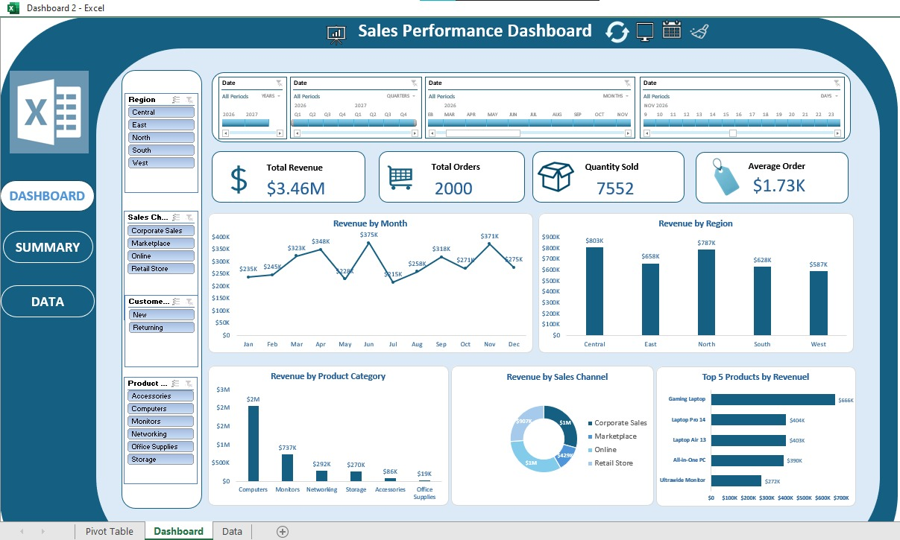

# Sales Performance Dashboard (Excel)

An interactive sales dashboard built in **Microsoft Excel** using PivotTables, PivotCharts, Slicers, Timelines and VBA macros. It turns 2,000 raw sales orders into a one-page view of revenue, orders, products, regions and sales channels, so anyone can filter and explore the numbers without writing formulas.



---

## Project Overview

| Item | Details |
|---|---|
| Tool | Microsoft Excel |
| File | `Dashboard_.xlsm` (macro-enabled) |
| Dataset | 2,000 sales orders, January to December 2026 |
| Techniques | PivotTables, PivotCharts, Slicers, Timelines, KPI cards, VBA macros, dashboard design |

## Business Questions Answered

- How much revenue are we generating, and from how many orders?
- What is the average order value?
- How does revenue change month by month?
- Which regions, product categories and sales channels perform best?
- Which are the top 5 products by revenue?
- How do results differ for new vs. returning customers?

## Workbook Structure

1. **Dashboard**: the one-page view with KPI cards, charts, slicers and timelines.
2. **Pivot Table**: the PivotTables that feed every KPI and chart.
3. **Data**: the raw sales data (2,000 rows).

### Dataset Columns

`Order ID`, `Date`, `Region`, `Sales Channel`, `Customer Type`, `Product Category`, `Product`, `Salesperson`, `Quantity`, `Unit Price`, `Discount`, `Revenue`

Revenue is calculated as `Quantity × Unit Price × (1 − Discount)`.

## Dashboard Features

### KPI Cards
| KPI | Value |
|---|---|
| Total Revenue | $3.46M |
| Total Orders | 2,000 |
| Quantity Sold | 7,552 |
| Average Order Value | $1.73K |

### Charts
- **Revenue by Month**: line chart showing the monthly trend
- **Revenue by Region**: column chart comparing the five regions
- **Revenue by Product Category**: column chart across six categories
- **Revenue by Sales Channel**: doughnut chart of channel share
- **Top 5 Products by Revenue**: bar chart of the best sellers

### Interactive Filters
- **Slicers**: Region, Sales Channel, Customer Type, Product Category
- **Date timelines**: filter by Years, Quarters, Months or Days

All slicers and timelines are connected to every PivotTable, so one click updates the whole dashboard.

### Navigation and Macro Buttons
- **DASHBOARD / SUMMARY / DATA** buttons on the left to move between views
- Clickable icons in the header powered by VBA macros: **refresh all data**, **toggle full screen** and **clear all slicers**

## Key Insights

- **Total revenue is $3.46M** from 2,000 orders (7,552 units), with an average order value of **$1.73K**.
- **Central is the top region** ($803K), closely followed by North ($787K). West is the lowest ($587K).
- **Computers dominate sales** at about $2M (roughly 59% of revenue). Monitors are second ($737K). Office Supplies add only $19K.
- **Top product is the Gaming Laptop** ($666K), followed by Laptop Pro 14 ($404K) and Laptop Air 13 ($403K). Laptops and computers fill four of the top five spots.
- **Monthly revenue is volatile.** It peaks in June ($375K) and November ($371K), and dips in July ($215K) and May ($228K).

## How to Use

1. Download `Dashboard_.xlsm` from this repository.
2. Open it in desktop Microsoft Excel (2013 or later). Slicers and timelines need the desktop version.
3. Click **Enable Content** if Excel shows a macro warning. The header buttons need macros to work.
4. Use the slicers and date timelines to filter. Use the broom icon to clear all filters.
5. Press **Ctrl + Shift + F1**, or use the monitor icon, for full screen.

> GitHub cannot display Excel slicers and PivotCharts interactively, so please download the file to explore it.

## VBA Macros Used

```vba
Sub RefreshDashboard()
    ThisWorkbook.RefreshAll
End Sub

Sub ClearAllSlicers()
    Dim sc As SlicerCache
    For Each sc In ThisWorkbook.SlicerCaches
        sc.ClearManualFilter
    Next sc
End Sub

Sub ToggleFullScreen()
    Application.DisplayFullScreen = Not Application.DisplayFullScreen
End Sub
```

## Skills Demonstrated

- Data cleaning and preparation
- PivotTable and PivotChart creation
- Slicers and timelines for interactivity
- KPI design and dashboard layout
- VBA macros assigned to buttons
- Turning data into business insights

## Repository Contents

```
Sales-Dashboard/
├── Dashboard_.xlsm    # Excel dashboard
├── dashboard.jpeg     # Dashboard screenshot
└── README.md          # Project documentation
```

## Author

**Gunashekar**
GitHub: [@gunashekar751](https://github.com/gunashekar751)
